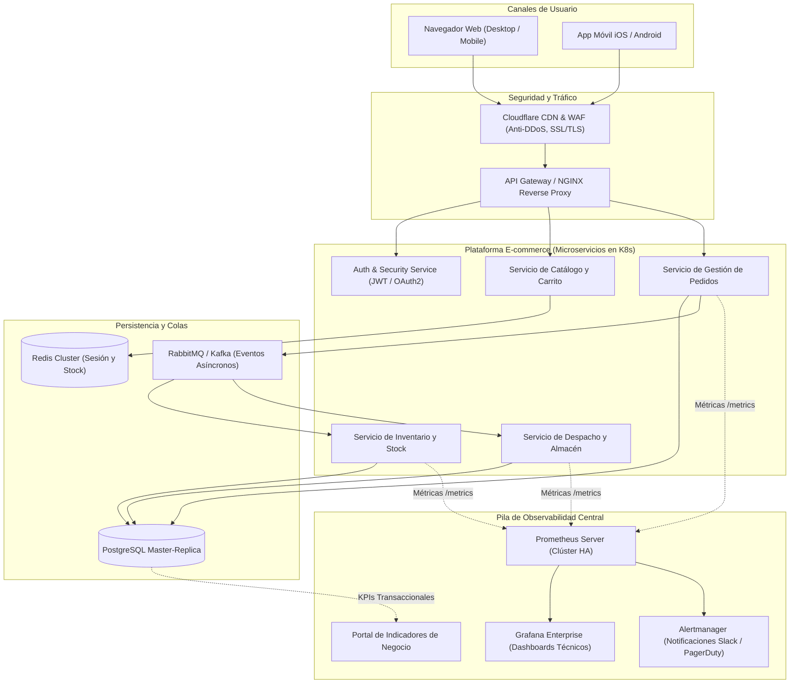
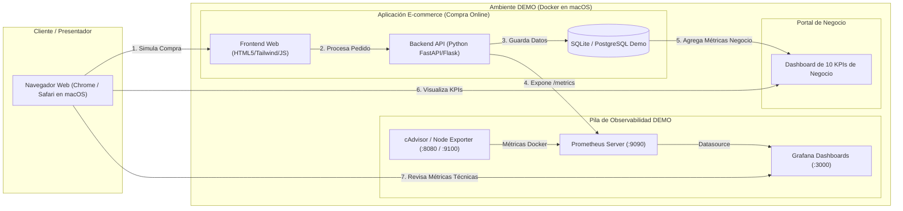

# Guía Técnica e Instrucciones del Avance 2: Proyecto Final de Telemática
**Curso:** Introducción a la Telemática  
**Programa:** Maestría en Informática — Universidad Mariano Gálvez de Guatemala  
**Grupo #3:**  
- Carlos Daniel López Hernández (096-19-5203)
- Victor Javier Castillo (092-19-7011)
- Oscar Geovany Ortíz Barillas (092-17-6969)
- Emmanuel Alexander Ajsivinac Yoc (092-20-7654)

**Proceso de Negocio:** Gestión de Pedidos de una Tienda E-commerce (Compra Online)  
**Herramienta de Monitoreo Seleccionada:** Prometheus + Grafana (con Node Exporter y cAdvisor en Docker)  
**Archivo Obligatorio de Entrega:** `avances_proyecto_grupo.pptx`

---

## 1. Contexto y Aclaración Crucial sobre el Entorno (macOS vs Windows Server)

### ¿Debemos usar Windows Server para el proyecto final?
**NO, no es obligatorio ni necesario usar Windows Server.**

#### Explicación técnica y estratégica:
1. **La plantilla y rúbrica oficial del docente no exigen Windows Server:** La presentación oficial del docente (`Avance_2_Telematica_Universidad_Mariano_Galvez.pptx`) establece claramente que los ejemplos son ilustrativos y solicita documentar *"los componentes y servicios efectivamente utilizados en su proyecto"*.
2. **Coherencia con el Benchmarking realizado:** En el informe técnico de 57 páginas (`BenchMarking_HerramientasObserbavilidad.pdf.pdf`), el Grupo #3 seleccionó y validó **Prometheus + Docker Compose + Node Exporter + cAdvisor + Avalanche**. Toda esta arquitectura es nativa de contenedores Linux y se ejecuta de manera idéntica y sin problemas en **macOS** (mediante Docker Desktop u OrbStack) y en Linux de producción.
3. **Diferenciación solicitada por el docente (Solución REAL vs Solución DEMO):**
   - El docente solicita explícitamente dos diagramas separados:
     - **Diagrama de Solución REAL:** Se modela una arquitectura empresarial en la nube (AWS / GCP / Azure o Kubernetes), con alta disponibilidad, balanceador de carga, WAF, pasarela y microservicios.
     - **Diagrama de Solución DEMO:** Es la maqueta funcional desplegada para la demostración en clase (levantada en macOS con Docker o desplegada en un servicio cloud gratuito/local como Render, Vercel o Railway).

> [!NOTE]
> Trabajar en macOS con Docker Compose para la DEMO es completamente válido, profesional y reproduce al 100% los contenedores que se usarían en un servidor productivo Linux. No se requiere Windows Server.

---

## 2. Requisitos y Estructura del Avance 2

El Avance 2 debe entregarse en formato PowerPoint con el nombre exacto:
`avances_proyecto_grupo.pptx`

Debe conservar las diapositivas del **Avance 1** (carátula, integrantes, proceso seleccionado, matriz de indicadores) y agregar **5 nuevas diapositivas obligatorias**:

```
┌────────────────────────────────────────────────────────┐
│               ESTRUCTURA DE LA PRESENTACIÓN            │
├────────────────────────────────────────────────────────┤
│ [Avance 1] Diapositiva 1: Carátula e Integrantes        │
│ [Avance 1] Diapositiva 2: Justificación del Proceso     │
│ [Avance 1] Diapositiva 3: Diagrama BPMN del Proceso     │
│ [Avance 2] Diapositiva 4: (Entregable 1) Solución REAL  │
│ [Avance 2] Diapositiva 5: (Entregable 2) Solución DEMO  │
│ [Avance 2] Diapositiva 6: (Entregable 3) App Desplegada │
│ [Avance 2] Diapositiva 7: (Entregable 4) 10 KPIs Negocio│
│ [Avance 2] Diapositiva 8: (Entregable 5) Monitoreo      │
│ [Cierre]   Diapositiva 9: Conclusiones y Demostración   │
└────────────────────────────────────────────────────────┘
```

---

## 3. Detalle de los 5 Entregables Requeridos

### Entregable 1: Diagrama de la Solución REAL (Arquitectura de Producción)
Presenta la arquitectura ideal de comercio electrónico a nivel empresarial, documentando la alta disponibilidad, seguridad perimetral, desacoplamiento y observabilidad integral.



**Puntos a destacar en la diapositiva:**
- Segmentación por capas (Cliente, Borde, Servicios, Persistencia, Observabilidad).
- Flujo asíncrono desacoplado para liquidación y despacho.
- Base de datos transaccional y caché en memoria para alto tráfico de compras.

---

### Entregable 2: Diagrama de la Solución DEMO (Arquitectura Implementada en Mac/Docker)
Ilustra exactamente lo que se implementa y corre para la clase en vivo. Se debe explicitar qué componentes son simulados y cuáles son reales.



#### Tabla Comparativa: Real vs DEMO (Requerimiento de la rúbrica)
| Componente | Solución Real (Producción) | Solución DEMO (Demostración Clase) | Justificación de la Diferencia |
| :--- | :--- | :--- | :--- |
| **Infraestructura** | Kubernetes multi-nodo en AWS/GCP | Contenedores Docker en macOS / Despliegue Cloud gratuito | Facilidad de portabilidad y ejecución en vivo durante la clase. |
| **Pasarela de Pagos** | Pasarela real (Visa/Mastercard/Stripe) | Aprobación automática simulada de cobro | Evitar cobros bancarios reales y tokens financieros sensibles. |
| **Base de Datos** | Clúster PostgreSQL replicado con HA | Instancia Docker PostgreSQL o SQLite estructurada | Simplicidad de ejecución y reseteo rápido para pruebas. |
| **Servicios de Envío** | Integración API couriers externos (DHL, Cargo Expreso) | Simulación de tiempos de despacho y estados en BD | Desacoplamiento de dependencias de terceros fuera del control del grupo. |
| **Generador de Carga** | Tráfico orgánico de miles de usuarios | Avalanche + script de simulación de pedidos concurrentes | Capacidad de estresar el sistema bajo demanda durante la exposición. |

---

### Entregable 3: Aplicación Desplegada
Se debe demostrar que la tienda online es completamente funcional y permite ejecutar el ciclo de vida del pedido seleccionado:
1. **URL de acceso:** Enlace local (`http://localhost:...`) o público si se despliega en plataforma web (e.g. Vercel, Render o Netlify).
2. **Flujo operativo demostrable:**
   - Selección de artículos y adición al carrito.
   - Formulario de checkout: validación de datos de envío y facturación.
   - Validación automática de inventario (con stock vs sin stock).
   - Generación de identificador de pedido y confirmación.
   - Módulo de almacén/operación: botón para preparar liquidación, empaque y despacho ("Pedido enviado").
3. **Capturas de pantalla para la diapositiva:**
   - Catálogo de productos y carrito de compra.
   - Pantalla de confirmación de pedido generado exitosamente.
   - Pantalla de rechazo/aviso cuando no hay stock suficiente.
   - Panel de control de bodega/despacho con cambio de estado.

---

### Entregable 4: Portal de Indicadores de Negocio (Mínimo 10 KPIs)
En el Avance 1 se presentaron 7 indicadores (K01 a K07). La rúbrica del Avance 2 exige **un mínimo de 10 indicadores (KPIs)**. A continuación se presenta la matriz completa de los 10 KPIs de negocio calibrados para el proceso de compra online:

| ID | Nombre del Indicador | Fórmula y Unidad | Meta | Semáforo (V / A / R) | Etapa del Proceso |
| :---: | :--- | :--- | :---: | :--- | :--- |
| **K01** | **Volumen diario de solicitudes** | $N^\circ \text{ solicitudes registradas / día}$ | $\ge 100$ | **V:** $\ge 100$<br>**A:** $70\text{ a }99$<br>**R:** $< 70$ | Cliente: Carrito y Checkout |
| **K02** | **Porcentaje de datos válidos** | $\frac{\text{Solicitudes con datos válidos}}{\text{Total solicitudes evaluadas}} \times 100$ | $\ge 98\%$ | **V:** $\ge 98\%$<br>**A:** $95\%\text{ a }<98\%$<br>**R:** $< 95\%$ | Sistema: Validación de datos |
| **K03** | **Disponibilidad de stock** | $\frac{\text{Solicitudes válidas con stock}}{\text{Total solicitudes con datos válidos}} \times 100$ | $\ge 97\%$ | **V:** $\ge 97\%$<br>**A:** $90\%\text{ a }<97\%$<br>**R:** $< 90\%$ | Sistema: Validación de inventario |
| **K04** | **Efectividad de creación de pedidos** | $\frac{\text{Pedidos formalmente creados}}{\text{Solicitudes elegibles (datos+stock)}} \times 100$ | $\ge 99\%$ | **V:** $\ge 99\%$<br>**A:** $97\%\text{ a }<99\%$<br>**R:** $< 97\%$ | Sistema: Creación de pedido |
| **K05** | **Tasa de abandono en checkout** *(Nuevo)* | $\frac{\text{Carritos abandonados sin confirmar}}{\text{Total de carritos iniciados}} \times 100$ | $\le 20\%$ | **V:** $\le 20\%$<br>**A:** $>20\%\text{ a }30\%$<br>**R:** $> 30\%$ | Cliente: Intención de compra |
| **K06** | **Ticket promedio de compra** *(Nuevo)* | $\frac{\text{Monto monetario total de pedidos creados}}{\text{Total de pedidos creados}}$ (Q / pedido) | $\ge \text{Q }250$ | **V:** $\ge \text{Q }250$<br>**A:** $\text{Q }200\text{ a }\text{Q }249$<br>**R:** $<\text{Q }200$ | Sistema: Liquidación económica |
| **K07** | **Liquidaciones preparadas en plazo** | $\frac{\text{Pedidos con liquidación } \le 60\text{ min}}{\text{Pedidos con plazo de liquidación vencido}} \times 100$ | $\ge 95\%$ | **V:** $\ge 95\%$<br>**A:** $85\%\text{ a }<95\%$<br>**R:** $< 85\%$ | Almacén: Facturación/Liquidación |
| **K08** | **Tiempo medio de empaque** | $\frac{\sum \text{minutos empaque}}{\text{Total pedidos empacados}}$ (minutos/pedido) | $\le 30\text{ min}$ | **V:** $\le 30\text{ min}$<br>**A:** $>30\text{ a }\le 45\text{ min}$<br>**R:** $> 45\text{ min}$ | Almacén: Preparación y empaque |
| **K09** | **Cumplimiento de despacho en plazo** | $\frac{\text{Pedidos despachados } \le 8\text{ h}}{\text{Pedidos con plazo de despacho vencido}} \times 100$ | $\ge 95\%$ | **V:** $\ge 95\%$<br>**A:** $85\%\text{ a }<95\%$<br>**R:** $< 85\%$ | Almacén: Despacho final |
| **K10** | **Tiempo de ciclo completo (Order-to-Dispatch)** *(Nuevo)* | $\frac{\sum \text{horas desde creación hasta Pedido Enviado}}{\text{Total pedidos despachados}}$ (horas) | $\le 4\text{ h}$ | **V:** $\le 4\text{ h}$<br>**A:** $>4\text{ a }\le 6\text{ h}$<br>**R:** $> 6\text{ h}$ | Negocio: Lead Time Operativo |

> [!IMPORTANT]
> **Diferencia entre portal de negocio y monitoreo técnico:**
> - El **Portal de Negocio** mide pedidos, dinero, quiebre de stock, abandonos y cumplimiento de despacho (orientado al gerente de operaciones y ventas).
> - La **Herramienta de Monitoreo** mide CPU, RAM, latencia en ms, códigos de error HTTP y disponibilidad de puertos (orientado al equipo de infraestructura y telemática).

---

### Entregable 5: Herramienta de Monitoreo Técnico (Prometheus + Grafana)
Se documenta la herramienta seleccionada fundamentándose en el trabajo de benchmarking previo del grupo:

1. **Herramienta seleccionada:** **Prometheus + Grafana** (complementado con Node Exporter y cAdvisor).
2. **Justificación técnica:**
   - **Modelo de recolección Pull HTTP:** Evita saturación de la base de datos de monitoreo porque el servidor controla el intervalo de scrape (`scrape_interval: 15s`).
   - **Series temporales (TSDB) con dimensionalidad de etiquetas (Labels):** Permite filtrar dinámicamente por endpoint, método HTTP y código de respuesta (`job="ecommerce-app"`, `status="200"`).
   - **Bajo impacto de recursos:** Comprobado empíricamente en el benchmarking del grupo con Avalanche (capaz de ingerir miles de series con consumo de memoria controlado).
   - **Ecosistema estándar de la industria (Cloud Native Computing Foundation - CNCF).**
3. **Métricas técnicas supervisadas:**
   - **Disponibilidad (Healthcheck):** Métrica `up{job="ecommerce-app"}` (1 = UP, 0 = DOWN).
   - **Rendimiento y Rendimiento HTTP:** `rate(http_requests_total[1m])` (peticiones por segundo).
   - **Tasa de error HTTP (5xx / 4xx):** `sum(rate(http_requests_total{status=~"5.."}[1m])) / sum(rate(http_requests_total[1m])) * 100`.
   - **Latencia de respuesta:** Percentil 95 (`histogram_quantile(0.95, sum(rate(http_request_duration_seconds_bucket[5m])) by (le))`).
   - **Consumo de recursos del contenedor:** `container_memory_working_set_bytes` y `container_cpu_usage_seconds_total` vía cAdvisor.

---

## 4. Plan de Acción y Reparto Técnico para el Equipo en macOS

1. **Despliegue Local con Docker Compose en Mac:**
   - Unificar en un `docker-compose.yml`:
     - Contenedor de la Tienda E-commerce + API de pedidos.
     - Contenedor de Prometheus con el `prometheus.yml` que scrapea la app.
     - Contenedor de Grafana con el dashboard aprovisionado.
     - Contenedor del Portal Web de Indicadores (o integrado en la misma interfaz web con pestañas separadas).
2. **Construcción de la Presentación Final:**
   - Tomar como base `Avance1.pdf` y la plantilla `Avance_2_Telematica_Universidad_Mariano_Galvez.pptx`.
   - Generar el archivo oficial `avances_proyecto_grupo.pptx` con las 5 diapositivas requeridas.
3. **Preparación de la Demostración en Vivo:**
   - Realizar 3 pedidos simulados en vivo (2 exitosos, 1 sin stock).
   - Mostrar el impacto inmediato en el Portal de 10 Indicadores de Negocio.
   - Mostrar en Grafana/Prometheus la variación en las métricas de peticiones y latencia.

---

## 5. Criterios de Evaluación del Docente
- **Claridad y consistencia de los diagramas:** Coherencia entre la solución real y la solución demo.
- **Funcionamiento de la aplicación:** Demostración en vivo sin fallos de ejecución.
- **Pertinencia de los 10 indicadores de negocio:** Indicadores realistas con fórmulas y semáforos definidos.
- **Justificación de la herramienta de monitoreo:** Fundamento técnico sólido basado en métricas y observabilidad.
- **Dominio técnico durante la exposición:** Explicación fluida por parte de todos los integrantes.
